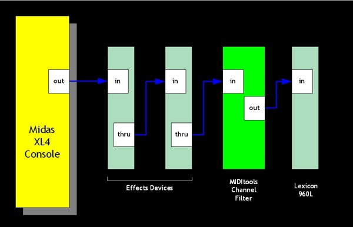
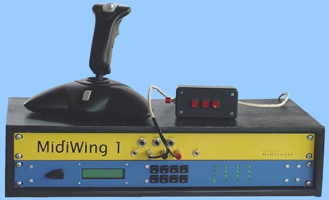
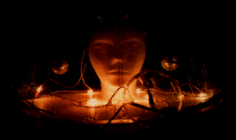
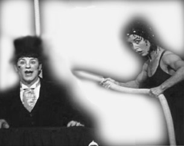
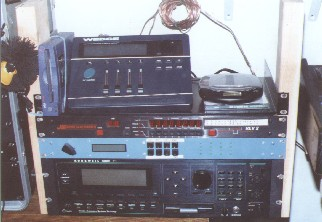
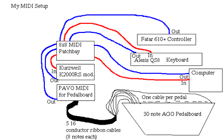
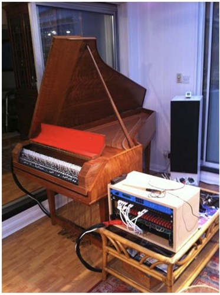
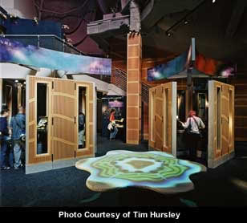

# User Projects

### Jeff Berryman, Jasonaudio

**The Project:** The Bryan Adams FOH mix kit is based around a Midas XL4 console and a string of MIDI-controlled effects devices. The XL4's MIDI automation system is used to control the effects devices. One of those devices, the legendary Lexicon 960L Digital Processor, responds on all 16 MIDI channels, effectively preventing other devices on the same MIDI chain from being controlled. To work around this problem, Jasonaudio uses a MIDItools® Channel Filter to isolate the 960L from the rest of the chain.

---

### Dan Daily

**Great New Product:** 

---

### Einar Ask

---

### Bret Battey and James Jay

---

### Mark Nichols

---

### Adam Levin

---

### Malcolm Messiter

- [Video on YouTube](https://www.youtube.com/watch?v=koUTb5rUDaI)
- [*Sounding Board* No. 4, British Harpsichord Society](https://www.messiter.com/BHS4.pdf) — see page 27

---

### Experience Music Project, Seattle, Washington

Two custom MIDItools® applications run continuously in the Sound Lab at EMP. One runs the MIDI channel routing for the Jamba Drum, shown in the foreground of the above photo. The audio in each practice pod (9) is switched via a MIDItools® clock and master switch with a custom relay board.
